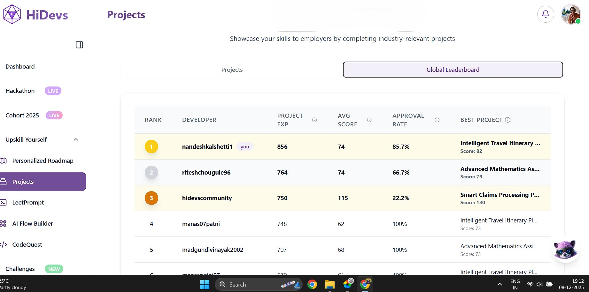
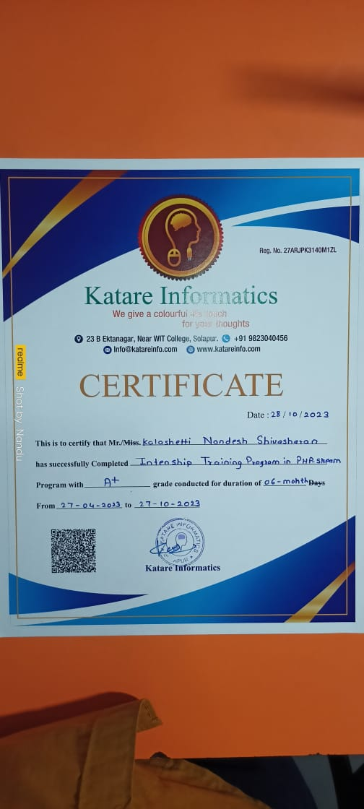

<!-- =========================================================
     NANDESH KALASHETTI — GitHub Profile README
     Keep README.md, hidevs.jpg and katare.jpg in the same
     repository folder so the certificate links work correctly.
     ========================================================= -->

  

  

  
  
  
  

  <a href="#about">ABOUT</a> &nbsp;·&nbsp;
  <a href="#focus">WHAT I DO</a> &nbsp;·&nbsp;
  <a href="#projects">PROJECTS</a> &nbsp;·&nbsp;
  <a href="#experience">EXPERIENCE</a> &nbsp;·&nbsp;
  <a href="#toolkit">TOOLKIT</a> &nbsp;·&nbsp;
  <a href="#github">GITHUB</a>

👋 About Me
Hi, I'm Nandesh Kalashetti — a developer interested in building software that makes complex ideas easier to use, understand, and explore.

My work brings together full-stack development, Generative AI, and interactive web experiences. I've worked on AI-assisted mathematics workflows, retrieval-augmented chat experiences, and 3D educational interfaces. I enjoy connecting the pieces end to end: the user experience, application logic, data, AI integration, and deployment.
My guiding idea: technology should be powerful under the hood and simple to use on the surface.

  <table>
    <tr>
      <td align="center" width="25%"><strong>🤖 Generative AI</strong> LLM integrations · RAG workflows</td>
      <td align="center" width="25%"><strong>🌐 Full Stack</strong> Interfaces · APIs · Databases</td>
      <td align="center" width="25%"><strong>🧊 Interactive Web</strong> 3D experiences · Visualization</td>
      <td align="center" width="25%"><strong>🏆 Recognition</strong> HiDevs global leaderboard · #1</td>
    </tr>
  </table>

- 📍 Based in: Solapur, Maharashtra, India
- 🎯 Interested in: AI-powered products, thoughtful software engineering, and technology for learning
- 🌱 Always exploring: better architecture, useful AI applications, and polished user experiences

🧭 What I Do
<table>
  <tr>
    <td width="50%" valign="top">
      <h3>01 · AI that helps people</h3>
      Build and experiment with LLM-powered applications, including math assistance and retrieval-augmented chatbot workflows.
        
      <strong>Focus:</strong> LLaMA 3 · RAG · OCR workflows · Streamlit
    </td>
    <td width="50%" valign="top">
      <h3>02 · Web experiences with depth</h3>
      Create responsive application interfaces and explore 3D experiences that make learning and interaction more visual.
        
      <strong>Focus:</strong> React · TypeScript · Three.js
    </td>
  </tr>
  <tr>
    <td width="50%" valign="top">
      <h3>03 · End-to-end application development</h3>
      Work across frontend logic, backend functionality, data storage, and application integration to turn ideas into usable products.
        
      <strong>Focus:</strong> PHP · MySQL · Firebase
    </td>
    <td width="50%" valign="top">
      <h3>04 · Learn, build, improve</h3>
      Approach projects as a cycle: understand the problem, build a practical solution, test the experience, and improve the details.
        
      <strong>Focus:</strong> Problem solving · Iteration · Clean user experience
    </td>
  </tr>
</table>

🚀 Selected Projects
<table>
  <tr>
    <td width="50%" valign="top">
      <h3 align="center">MathNexus 3D</h3>
      
<em>An interactive universe for learning mathematics</em>

      
      
<strong>The problem</strong> Mathematical ideas can be difficult to picture when they are presented only as symbols and text.

      
<strong>The approach</strong> An interactive, gamified 3D learning experience designed to make mathematical exploration more visual.

      
<strong>Built with</strong> <code>React</code> <code>TypeScript</code> <code>Three.js</code>

      

    </td>
    <td width="50%" valign="top">
      <h3 align="center">Math Assistant AI</h3>
      
<em>AI-assisted support for mathematical problem solving</em>

      
      
<strong>The problem</strong> Working with handwritten mathematical problems can make digital assistance harder to access.

      
<strong>The approach</strong> An OCR-assisted workflow paired with a LLaMA 3 integration to interpret math inputs and support solution generation.

      
<strong>Built with</strong> <code>Python</code> <code>Generative AI</code> <code>OCR</code> <code>LaTeX</code> <code>Streamlit</code>

      

    </td>
  </tr>
</table>

💼 Experience & Credentials
<table>
  <tr>
    <td width="62%" valign="top">
      <h3>Generative AI Developer · HiDevs</h3>
      February 2025 – May 2025
        
      - Ranked **#1 on the HiDevs global leaderboard** during the experience.
      - Worked on AI-powered math assistant and retrieval-augmented chatbot projects.
      - Integrated LLaMA 3 models into application workflows using Streamlit.
    </td>
    <td width="38%" align="center" valign="middle">
      
       
      <a href="./hidevs.jpg">View HiDevs certificate ↗</a>
    </td>
  </tr>
  <tr>
    <td width="62%" valign="top">
      <h3>Software Developer Intern · Katare Informatics</h3>
      April 2023 – October 2023
        
      - Received **Grade A+** for project delivery.
      - Developed projects including **ActivityHub** (EduTech) and E-Cart applications.
      - Worked across PHP and MySQL as part of the application development lifecycle.
    </td>
    <td width="38%" align="center" valign="middle">
      
       
      <a href="./katare.jpg">View Katare certificate ↗</a>
    </td>
  </tr>
</table>

Certificate images are stored in this repository. Select either thumbnail or its link to open the original image.

🧰 Toolkit

<strong>Languages, frameworks & tools</strong>

  

<strong>AI, architecture & technical concepts</strong>

  
  
  
  

📈 GitHub at a Glance

  
  

These cards are generated automatically by a third-party service, so they may occasionally load slowly or be unavailable.

🤝 Let's Build Something Meaningful
Have an interesting idea involving software, AI, or interactive learning? Let's connect and explore what we can build.

  
  
  

   
  

